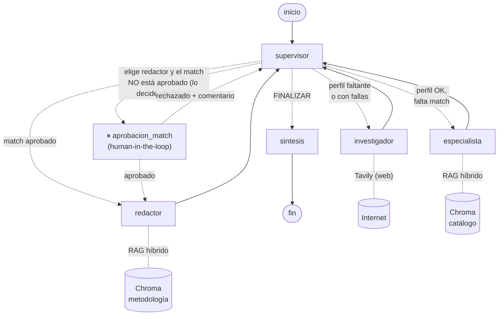
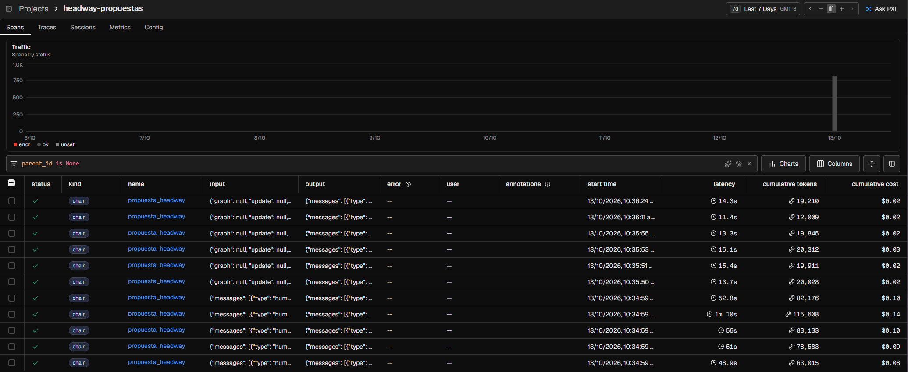
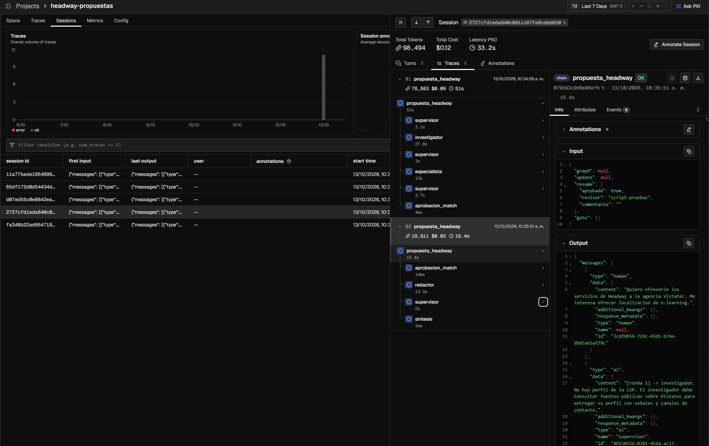
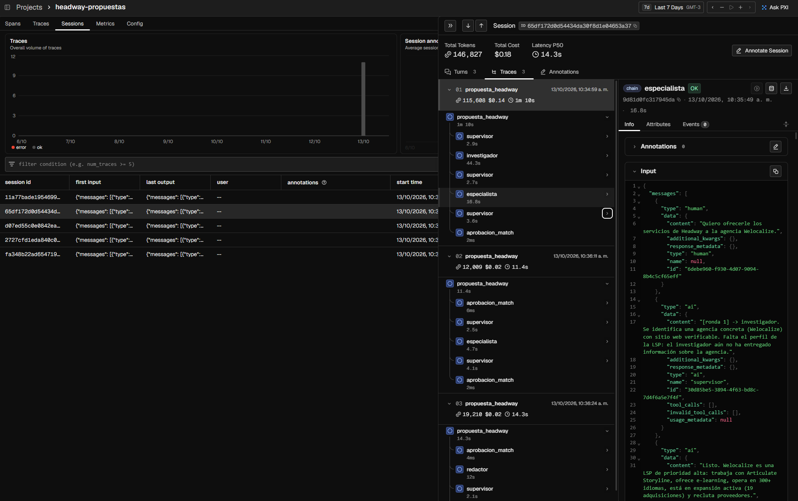
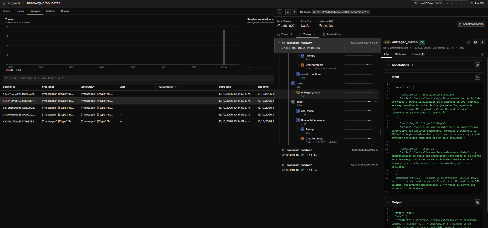
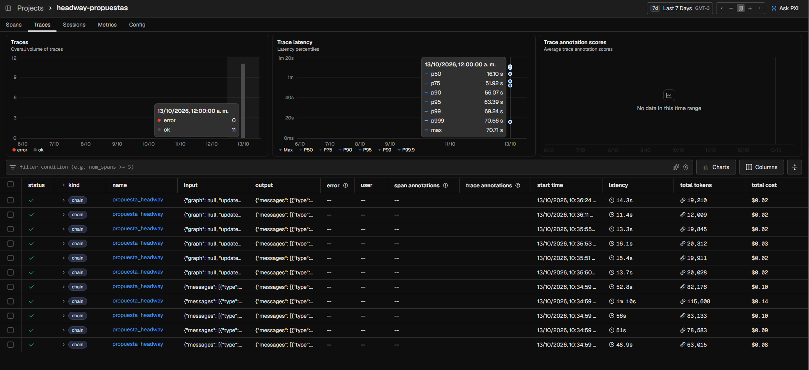

# Headway — Sistema de propuestas comerciales para agencias de localización

**Entrega final · AI Engineering (Coderhouse)** — Sistema multi-agente de grado de producción: RAG híbrido + agentes con Supervisor + aprobación humana + API asíncrona + trazabilidad completa.

> **En cinco minutos:** le decís a la API *"quiero ofrecerle mis servicios a la agencia X"*. Un **Supervisor** coordina a tres agentes. El **investigador** busca a la agencia en internet y arma su perfil con fuentes verificables. El **especialista** cruza ese perfil con el catálogo de Headway mediante **RAG**. **Una persona aprueba** los servicios elegidos. El **redactor** escribe el primer contacto siguiendo la metodología comercial (también vía RAG). Todo lo que el LLM entrega pasa por **contratos Pydantic** y **chequeos por código**. Cada ejecución queda trazada en **Arize Phoenix** y el estado persiste en **Redis**: una conversación pausada sobrevive a un reinicio del servidor.

---

## 1. El problema

[Headway](https://e-learninglocalization.com) es un estudio pequeño, cercano y confiable que trabaja para **agencias de localización (LSPs)**: localiza cursos de e-learning (Articulate Storyline, Rise, Figma) y hace DTP multilingüe. No traduce: trabaja con las agencias que traducen.

Conseguir una agencia nueva requiere:

1. investigar si tiene servicio de e-learning, si busca proveedores y por qué canal;
2. elegir qué servicios ofrecerle;
3. escribir un primer contacto breve, en el tono correcto y sin errores de precio.

El sistema automatiza esos tres pasos y deja la decisión comercial en manos de una persona.

## 2. Arquitectura

### 2.1 Grafo de agentes (LangGraph)



*(El diagrama generado por LangGraph a partir del grafo compilado está en [`docs/grafo.mmd`](docs/grafo.mmd); se regenera con `python main.py --diagrama`.)*

| Nodo | Responsabilidad única | Herramientas | Entrega (contrato Pydantic) |
|---|---|---|---|
| **Supervisor** | Coordina: decide quién interviene y escribe instrucciones autocontenidas. Nunca ejecuta | — (salida estructurada) | `DecisionSupervisor` |
| **Investigador** | Arma el perfil de la LSP con fuentes | `buscar_web`, `leer_pagina` (Tavily), `consultar_metodologia` | `PerfilLSP` (el **puntaje** lo calcula el código) |
| **Especialista** | Elige de 1 a 4 servicios del catálogo | `buscar_servicios` (RAG diversificado), `ver_ficha`, `consultar_metodologia` | `MatchServicios` (la **tarifa** la copia el código del catálogo) |
| **Aprobación** | Pausa el grafo hasta que una persona aprueba o rechaza | `interrupt()` | `DecisionHumana` |
| **Redactor** | Elige canal y piezas y redacta el primer mensaje | `consultar_metodologia` | `Propuesta` |
| **Síntesis** | Arma la respuesta final | — (**plantilla, sin LLM**) | Markdown |

### 2.2 Infraestructura (Docker Compose)

```
 Cliente            API (FastAPI)              Redis 8                 Worker
   │ POST /propuestas  │                          │                       │
   │──────────────────>│ valida (Pydantic) ──422  │                       │
   │<── 202 {job_id} ──│ job:<id>=PENDING ───────>│                       │
   │                   │ RPUSH cola ─────────────>│──── BLPOP ───────────>│ grafo.ainvoke()
   │ GET /propuestas/id│                          │<── checkpoints ───────│ thread_id = job_id
   │<── AWAITING_APPROVAL (servicios a aprobar) ──│<── ⏸ interrupt() ─────│ (el worker queda libre)
   │ POST .../aprobar  │── RPUSH "reanudar" ─────>│──── BLPOP ───────────>│ ▶ Command(resume=…)
   │<── DONE + propuesta ─────────────────────────│<── DONE ──────────────│
                                                                          │ OpenTelemetry
                    Chroma (RAG) <── AsyncHttpClient ─────────────────────┤
                    Tavily (web) <── AsyncTavilyClient ───────────────────┤
                                                              Arize Phoenix :6006
```

La API **nunca ejecuta el grafo**: una propuesta tarda entre 60 y 100 s, y mantener la conexión HTTP abierta ese tiempo terminaría en timeouts. La API valida, encola y responde en milisegundos; el cliente consulta el estado (*polling*). El worker ejecuta hasta 5 jobs a la vez (semáforo de asyncio).

## 3. Decisiones técnicas

### 3.1 RAG híbrido con filtros por metadatos

El corpus son 16 archivos Markdown escritos para este sistema ([`data/corpus/`](data/corpus/)):

- **catálogo**: una ficha por servicio;
- **metodología**: cómo venderle a una LSP (perfil del comprador, dolores, argumentos, criterios, reglas de contacto y de precio).

| Decisión | Por qué |
|---|---|
| **Chunking por sección** (`##`/`###`), no por cantidad de caracteres | El corpus se escribió para que cada sección se entienda sola; cortar por títulos respeta las unidades de significado |
| **Encabezado de contexto** en cada fragmento (`Servicio: Storyline (tarifa: 14 USD/h) \| Sección: Precio`) | Un fragmento que solo dice "14 USD/h" no sabe de qué servicio es |
| **Frontmatter → metadatos** (`prioridad`, `estado`, `tarifa`, `tipo`, `usado_por`) | Se usan como **filtros antes de buscar**. Un servicio `en_evaluacion` no aparece nunca: el agente no puede ofrecer lo que no ve. Es más confiable que pedirle al LLM "no ofrezcas X" |
| **Búsqueda híbrida**: vectores (Gemini) + BM25, fusionadas con **Reciprocal Rank Fusion** | La vectorial entiende significado ("el texto no entra en las pantallas" → Storyline); BM25 encuentra términos exactos ("RTL", "SCORM"). RRF combina **puestos**, no puntajes, porque las dos escalas no son comparables |
| **Diversificación** por `servicio_id` en la herramienta del especialista | Una búsqueda común devolvía 4 fragmentos del mismo servicio; el especialista necesita opciones distintas |
| **Indexado idempotente** por huella (hash del corpus + modelo de embeddings) | Si nada cambió, no se gasta una llamada. Si cambia el corpus **o el modelo de embeddings**, se re-indexa solo al arrancar el worker |
| **Chroma como servidor** + `AsyncHttpClient` | `PersistentClient` es sincrónico y bloquearía el event loop del worker |

**Dos proveedores, dos roles.** Claude Haiku 4.5 (Anthropic) razona. Gemini (`gemini-embedding-001`) solo genera los embeddings, porque Anthropic no ofrece un modelo de embeddings. Claude nunca ve un vector: recibe el texto de los fragmentos recuperados.

### 3.2 "Confiar, pero verificar": lo que decide el código y no el LLM

| Riesgo | Defensa en código |
|---|---|
| El investigador cita una fuente inventada | `entregar_perfil` rechaza toda URL que no haya salido de `buscar_web` o `leer_pagina` en esa corrida, y el chequeo `fuentes_consultadas` lo vuelve a verificar contra la evidencia |
| El LLM suma mal el puntaje de la agencia | `PerfilLSP.puntaje` es un `computed_field`: lo calcula Python a partir de los criterios con fuente |
| El especialista ofrece un servicio que no existe o está en evaluación | `entregar_match` valida contra el catálogo y **copia** nombre, prioridad y tarifa; el LLM solo elige qué y por qué |
| Un adicional (crear cursos) presentado como lo principal | Si el match tiene solo adicionales, se rechaza; si los mezcla, los manda al final |
| **El redactor inventa un precio** | `revisar_propuesta` extrae todo precio del mensaje y lo compara con las tarifas aprobadas. "15 USD/h" → rechazo y corrección |
| Tono exagerado ("exactly what you need to scale…") | Se rechaza por patrón: contradice el posicionamiento de Headway |
| Mensaje demasiado largo o sin oferta de prueba | Email: 50–125 palabras, asunto de 4–7; siempre ofrecer un test |
| El redactor escribe sin aprobación humana | `rutear()` lo manda a `aprobacion_match` si la versión del match no está aprobada |
| El Supervisor da por terminada una tarea incompleta | `task_completed` solo es `True` si **todos** los chequeos automáticos dan OK |
| El Supervisor insiste en un agente que no puede avanzar | Detector de estancamiento: si un agente no entrega dos veces seguidas, el código cierra y explica por qué |
| La síntesis "mejora" el mensaje ya validado | La síntesis es una **plantilla**: lo que se validó es exactamente lo que se entrega |

Cuando una herramienta rechaza una entrega, el error vuelve al agente como respuesta de la herramienta y el ciclo ReAct corrige en el momento.

### 3.3 Human-in-the-loop con versiones

Una aprobación vale para **una versión** del match. Si la persona rechaza con un comentario ("dejá solo los dos principales"), el Supervisor manda al especialista a corregir, la versión sube a 2 y el grafo vuelve a pausarse. En la API, el candado anti doble respuesta (`SET NX`) también es por versión.

### 3.4 Persistencia (Checkpointer) y validación (Pydantic)

- **Checkpointer `AsyncRedisSaver`** (Redis 8). El `thread_id` es el `job_id`: un job pausado en la aprobación sobrevive a un reinicio del worker o del servidor.
- Redis guarda los checkpoints como JSON. Los modelos Pydantic del estado se declaran en `allowed_json_modules`: sin eso vuelven como `dict` al reanudar. Hay un test de regresión.
- **Pydantic en todas las fronteras.** Entrada de la API (`PedidoPropuesta`: `agencia` obligatoria y sin marcadores `<…>`), respuesta humana (`DecisionHumana`), argumentos de **cada herramienta**, entregas de los agentes y estado del grafo.

### 3.5 Todo asincrónico

LLM (`ainvoke`), embeddings (`client.aio`), Chroma (`AsyncHttpClient`), Tavily (`AsyncTavilyClient`), Redis (`redis.asyncio`), API (FastAPI) y worker (`asyncio` + semáforo). La lectura de archivos y el `input()` de la CLI van por `asyncio.to_thread`. No hay `requests` en el proyecto.

### 3.6 Configuración sin hard-coding

Modelos, URLs, prefijo de las colecciones de Chroma, límites y claves salen del `.env` ([`.env.example`](.env.example)), y solo `comun/config.py` los lee. Dentro de Docker Compose, las direcciones internas (`redis`, `chroma`, `phoenix`) se pisan en el `docker-compose.yml`.

## 4. Observabilidad: las 5 pruebas

`python scripts/pruebas.py` corre los 5 casos de [`scripts/pruebas.json`](scripts/pruebas.json) contra la API, al mismo tiempo, con la misma etiqueta. Responde las aprobaciones (en un caso **rechaza primero**), prueba un pedido inválido y consulta a Phoenix el costo y la latencia. Resultado completo, con los 5 mensajes generados: [`docs/pruebas_finales.md`](docs/pruebas_finales.md).

| # | Agencia | Recorrido | Puntaje | Aprobación | Canal | Duración |
|---|---|---|---|---|---|---|
| 1 | Vistatec | investigador → especialista → redactor → FINALIZAR | 8/11 | v1 aprobada | portal | 67 s |
| 2 | Welocalize | investigador → especialista → redactor → **especialista → redactor** → FINALIZAR | 10/11 | **v1 rechazada → v2 aprobada** | portal | 97 s |
| 3 | Alpha CRC | investigador → especialista → redactor → FINALIZAR | 9/11 | v1 aprobada | portal | 69 s |
| 4 | SeproTec (mensaje en español) | investigador → especialista → redactor → FINALIZAR | 11/11 | v1 aprobada | email | 70 s |
| 5 | Lionbridge | investigador → especialista → redactor → FINALIZAR | 8/11 | v1 aprobada | portal | 63 s |
| — | `agencia: "<nombre>"` | — | — | — | **HTTP 422** | — |

**Métricas de Phoenix** (filtro `metadata['etiqueta'] == 'pruebas-20261013-103458'`): 11 trazas (cada caso deja una traza al iniciar y otra por cada reanudación), **US$ 0,65 en total**, unos US$ 0,13 por propuesta completa, y 505.126 tokens de entrada contra 28.704 de salida. El p50 de Phoenix (16 s) incluye las trazas cortas de reanudación; la duración real de cada propuesta es la de la tabla.

Cada span lleva `session.id = job_id` (la ejecución inicial y las reanudaciones quedan agrupadas), la agencia, el modelo, el modelo de embeddings y la versión de los prompts.

**Las 11 trazas raíz de las pruebas** (latencia, tokens y costo por ejecución):



**Una sesión completa (Vistatec):** la traza 1 corre supervisor → investigador → especialista → supervisor y se pausa en `aprobacion_match`. La traza 2 es la reanudación con `"aprobado": true` → redactor → síntesis.



**Human-in-the-loop con rechazo (Welocalize):** tres trazas en la misma sesión: inicio, rechazo (el especialista arma la versión 2) y aprobación.



**La validación en acción:** el especialista intentó entregar un argumento central con *"escalar"*. La herramienta `entregar_match` lo rechazó (`"Tono exagerado en el argumento central: ['escalar']"`) y el agente corrigió en el mismo ciclo ReAct.



**Latencia por percentiles y estado de las trazas** (11 OK, 0 errores):



### Lo que enseñaron las trazas

Las primeras corridas reales fallaron, y las trazas mostraron por qué. Cada hallazgo se convirtió en una defensa en código y en un test de regresión:

1. **Pedido sin agencia** (`<nombre>` literal). El investigador hizo bien en no inventar, pero el Supervisor lo mandó 8 veces a "pedir el dato". Se agregó el detector de estancamiento, la validación de entrada en la API (422) y la regla de que los agentes no le piden datos a la persona.
2. **El investigador nunca entregaba.** Encontraba todo en 6 búsquedas pero seguía buscando hasta quedarse sin pasos, y su entrega llegaba vacía (`{}`) por el límite de tokens de salida. Se agregó un presupuesto de búsquedas aplicado por la herramienta, se subió el límite de pasos y de tokens, y se limpian los menús de las páginas leídas.
3. **Revisión de la dueña de Headway.** El primer mensaje decía *"exactly what Vistatec needs to scale…"*, y Headway es un estudio pequeño y cercano, no una empresa para escalar. Además ofrecía "crear cursos" como servicio central. Se reescribió el posicionamiento en el corpus, se marcó la creación de cursos como adicional y se agregó el chequeo de tono.

## 5. Cómo levantarlo

**Requisitos:** Docker Desktop (la imagen usa Python 3.12, declarado también en `.python-version`) y tres claves: Anthropic, Google AI Studio (embeddings, gratuita) y Tavily (gratuita).

```bash
cp .env.example .env            # en Windows: copy .env.example .env  → completar las 3 claves
docker compose up --build       # API, worker, Redis, Chroma y Phoenix
```

- **API y documentación interactiva:** http://localhost:8000/docs
- **Trazas:** http://localhost:6006

Uso por la API:

```bash
curl -X POST localhost:8000/propuestas -H "Content-Type: application/json" \
     -d '{"agencia": "Vistatec", "indicaciones": "Me interesa ofrecer localización de e-learning."}'
curl localhost:8000/propuestas/<job_id>                                   # polling
curl -X POST localhost:8000/propuestas/<job_id>/aprobar -H "Content-Type: application/json" \
     -d '{"aprobado": false, "revisor": "carla", "comentario": "Sacá DTP"}'
```

Otras formas de usarlo:

```bash
python scripts/pruebas.py                     # las 5 pruebas oficiales (con el sistema levantado)
python main.py "Quiero ofrecerle e-learning a la agencia Vistatec"   # CLI: aprobación en la terminal
python -m rag.consultar "LSP que busca proveedores de Storyline en árabe"   # ver el RAG en acción
python -m pytest -q                           # 43 tests, sin gastar la API (modelo y web simulados)
```

## 6. Tests

43 tests corren **sin gastar una llamada a la API**: el LLM es un guion (`ModeloSimulado`) y la web es un diccionario (`WebSimulada`). Todo lo demás es real: herramientas, validaciones, RAG (Chroma con embeddings simulados), grafo, checkpointer, API, cola y worker (Redis en memoria con `fakeredis`). Los tests que necesitan Chroma se saltean si no está levantado.

Cubren, entre otros:

- flujo completo con aprobación;
- rechazo → versión 2 → aprobación;
- precio inventado → corrección;
- fuente inventada → rechazo;
- servicio en evaluación;
- QA no pedido;
- adicional como único servicio;
- tono exagerado;
- límite de rondas;
- estancamiento;
- presupuesto de búsquedas;
- serializador de Redis;
- entradas inválidas (422);
- doble aprobación (409).

## 7. Estructura

```
app/          API (FastAPI), cola y registro de jobs (Redis), worker, human-in-the-loop, Phoenix
agents/       supervisor, investigador, especialista, redactor, síntesis
              reglas.py (reglas de negocio) · validacion.py (chequeos automáticos)
rag/          corpus → fragmentos → embeddings → Chroma · búsqueda híbrida · catálogo · indexado
comun/        configuración (.env), LLM, reintentos, Tavily, recursos
state.py      estado del grafo y contratos Pydantic
graph.py      grafo, ruteo y checkpointers
data/corpus/  catálogo (10 fichas) y metodología (6 documentos)
scripts/      pruebas oficiales y métricas de Phoenix
tests/        43 tests offline
docs/         diagrama del grafo y resultado de las pruebas
```

Evolución de las pre-entregas: el patrón **agente ReAct + herramienta `entregar_…` + evidencia** y los módulos `comun/` vienen de la PE5 y la PE6. La API, la cola, el worker, el checkpointer en Redis y Phoenix vienen de la PE7. Lo nuevo de esta entrega: el dominio, el **RAG híbrido**, la búsqueda web, el HITL con versiones, las reglas de negocio por código y el despliegue completo en Docker Compose.

## 8. Límites y próximos pasos

- **Modo prospección** ("buscame 5 LSPs con división de e-learning"): el corpus ya incluye los criterios de puntaje (`04_criterios_lsp_ideal.md`). Falta una herramienta `buscar_prospectos` y un paso de aprobación para elegir agencias.
- **El tono se verifica por patrones**: frena las exageraciones conocidas, pero no garantiza un buen estilo. Un evaluador LLM (*LLM-as-judge*) sería el siguiente paso.
- **Costo**: la mayor parte de los tokens de entrada son páginas web leídas. Resumirlas antes de pasárselas al agente bajaría el costo.
- **Datos de clientes**: por diseño, el corpus no contiene nombres ni contactos de clientes de Headway (el repo es público).
